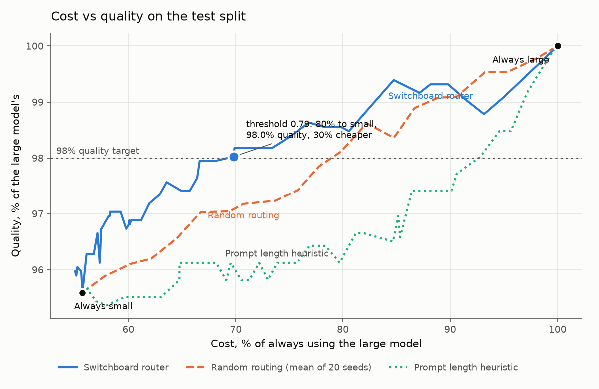

# Switchboard

A learned LLM router. For each prompt, a small fine tuned classifier decides whether a cheap
small model is good enough or the request needs an expensive large model. It runs behind an
OpenAI compatible proxy, so a client only changes its base URL and sets `"model": "auto"`.

[Demo](https://huggingface.co/spaces/Ilf-Ali/switchboard) (runs in the browser) ·
[Model](https://huggingface.co/Ilf-Ali/switchboard-router) ·
[Dataset](https://huggingface.co/datasets/Ilf-Ali/switchboard-routing)

> **At threshold 0.79, Switchboard sends 80% of prompts to the small model and keeps 98.0% of the large model's quality, cutting cost by 30%.**



The router beats random routing at the same share on 20/20 seeds: mean judge score 4.30 against 4.23 ± 0.02. The threshold was picked on the validation split (299 prompts)
as the cheapest point that keeps 98% of the large model's quality. All numbers below are
measured on the held out test split (300 prompts) at that threshold.

| Strategy | Sent to small | Mean judge score | Quality kept | Cost cut |
|---|---|---|---|---|
| **Switchboard router** | 80% | 4.30 | 98.0% | 30% |
| Random routing, same share (mean of 20 seeds) | 80% | 4.23 | 96.5% | 36% |
| Prompt length heuristic, same share | 80% | 4.19 | 95.5% | 37% |
| Always small | 100% | 4.19 | 95.6% | 44% |
| Always large | 0% | 4.39 | 100.0% | 0% |

At the same share the router costs a little more than random routing, because the prompts it
keeps on the large model are the hard ones with long answers. At the same quality it is
cheaper, as the chart shows: random routing needs a larger share of large model calls to reach
the quality target.

Small model: `openai/gpt-oss-20b`. Large model: `openai/gpt-oss-120b`. Both on Groq. Cost uses the real
token usage of every answer and Groq's prices per million tokens (input / output), checked on
2026-10-16: small $0.075 / $0.3, large $0.15 / $0.6. The small model is half the
price per token but writes longer answers, so even always using it cuts cost by less than half.

<!-- This file is generated from docs/README.template.md by `python -m switchboard.eval.readme`.
     Edit the template, not this file. -->

## Where the router makes its choices

| Category | Test prompts | Sent to small | Quality kept | Cost cut |
|---|---|---|---|---|
| coding | 60 | 100% | 98.6% | 56% |
| factual_qa | 63 | 73% | 97.2% | 31% |
| general_instruction | 96 | 54% | 96.8% | 19% |
| math | 60 | 100% | 100.0% | 34% |
| summarization | 21 | 100% | 97.9% | 38% |

Coding, math and summarization prompts almost always get a good enough answer from the small
model, and the router learned to send them all there. The real decisions happen on open ended
instructions and factual questions.

## How it works

1. **Collect prompts** from public Hugging Face datasets: `databricks/databricks-dolly-15k`
   (CC BY-SA 3.0), `OpenAssistant/oasst1` (Apache 2.0), `openai/gsm8k` (MIT) and
   `google-research-datasets/mbpp` (CC BY 4.0). English, single turn, deduplicated, split into
   train, val and test by source with a fixed seed.
2. **Answer every prompt** with both models at temperature 0, recording tokens and latency.
3. **Score every answer.** Math and coding answers are checked against the dataset's reference
   answer. The rest are scored 1 to 5 by an LLM judge (`qwen/qwen3.8-27b`, a different model
   family) that sees one answer at a time and never learns which model wrote it. The label is
   `small_ok = small_score >= large_score`.
4. **Check the judge** against 100 hand labelled rows: 80% agreement, Cohen's
   kappa 0.52. The judge is more lenient than the hand labels: it calls the small answer
   good enough on 77% of these rows, against 65% by hand.
5. **Train** `answerdotai/ModernBERT-base` as a binary classifier on the prompt alone (1398 train
   prompts, 85% labelled `small_ok`). The learning rate was tuned on val (best
   2e-05). ROC AUC: 0.77 on val, 0.73 on test.
6. **Evaluate** on test against always small, always large, random routing at the same share
   and a prompt length heuristic.
7. **Serve** it as a FastAPI proxy. Classifier overhead on CPU (4 threads, Apple
   silicon, 200 test prompts): p50 50 ms, p95 134 ms.

## Use the proxy

```bash
curl http://localhost:8100/v1/chat/completions \
  -H "Authorization: Bearer $PROXY_API_KEY" \
  -H "Content-Type: application/json" \
  -d '{"model": "auto", "messages": [{"role": "user", "content": "What is the capital of France?"}]}'
```

- `"model": "auto"` routes through the classifier. The small or large model ID passes through
  unchanged. Any other value returns 400.
- `stream: true` passes the upstream server sent events through unchanged.
- Response headers `X-Router-Model` and `X-Router-Score` show the decision.
- If the classifier fails, the request goes to the large model. If the small model fails, it is
  retried once on the large model.
- Every decision is appended to a JSONL log with a hash of the prompt, never the prompt text.
  `GET /stats` summarizes it: request count, share sent to small and estimated savings.

Run it with Docker (needs `models/router/`, `results/results.json` and a `.env` with
`GROQ_API_KEY` and `PROXY_API_KEY`):

```bash
docker compose up -d --build
```

## Reproduce

Needs Python 3.11+, [uv](https://docs.astral.sh/uv/) and a Groq API key in `.env` (see
`.env.example`). API calls are cached on disk, so reruns are free and a stopped run resumes.

```bash
uv sync
uv run python -m switchboard.data.collect
uv run python -m switchboard.data.generate
uv run python -m switchboard.data.judge
uv run python -m switchboard.data.calibrate
uv run python -m switchboard.train.train
uv run python -m switchboard.eval.evaluate
uv run python -m switchboard.serve.bench
uv run python -m switchboard.eval.readme
uv run uvicorn switchboard.serve.app:app --port 8100
uv run pytest
```

Every script accepts `--limit N` for a small trial run. Training also runs on a free Colab GPU
with `notebooks/train_colab.ipynb`. Model IDs, prices and thresholds live in
`config/settings.yaml`.

## Limitations

- **English only**, and only the kinds of prompts in the four source datasets.
- **Judge bias.** Quality is the judge's score, and the judge is more lenient than a human
  (kappa 0.52). "Quality kept" means kept by the judge's standard.
- **Models change.** The labels describe `openai/gpt-oss-20b` and `openai/gpt-oss-120b` on Groq as of
  2026-10-16. A different model pair needs new labels.
- **Small test split.** 300 test prompts, so per category numbers are noisy.

## Prior work

Switchboard follows the idea of learned routing between a cheap and a strong model:

- Ong et al., [RouteLLM: Learning to Route LLMs with Preference Data](https://arxiv.org/abs/2406.18665), 2024.
- Chen et al., [FrugalGPT: How to Use Large Language Models While Reducing Cost and Improving Performance](https://arxiv.org/abs/2305.05176), 2023.
